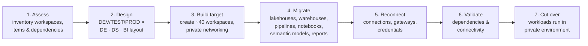
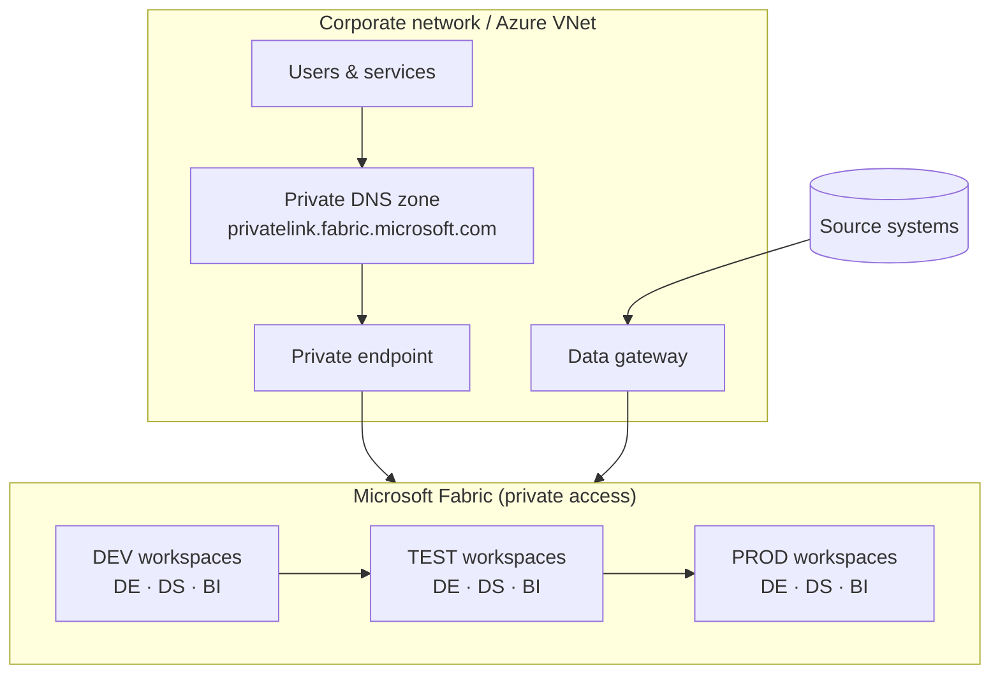

# Microsoft Fabric: Public-to-Private Network Migration

> An enterprise migration of a Microsoft Fabric data and analytics platform from public network access to a **private, network-isolated environment** using **Azure Private Link and private endpoints**. Around 40 new workspaces were set up across DEV, TEST and PROD, and data engineering, data science and BI workloads were moved over without breaking them.

`Microsoft Fabric` · `Azure Private Link` · `Private endpoints` · `Private DNS` · `Lakehouse` · `Warehouse` · `Data pipelines` · `Notebooks` · `Power BI` · `On-premises data gateway`

---

## Overview

In regulated industries like banking, analytics platforms are expected to keep traffic off the public internet. This project moved a bank's Fabric estate from public access to a **secured private environment**, and restructured it at the same time into a governed DEV / TEST / PROD layout organized by domain.

## Problem and goals

**Problem**
- The existing Fabric environment was reachable over public endpoints, which didn't meet the bank's network-isolation and security requirements.
- Workspaces had grown organically, with no consistent separation between environments or domains.

**Goals**
- Move platform connectivity to private networking.
- Create a clean, governed workspace structure across environments and domains.
- Migrate every asset and dependency with **no loss of function** for existing workloads.

## Scope

| Area | What was migrated or configured |
|---|---|
| Workspaces | About **40 new workspaces** across **Development, Test and Production**, covering **Data Engineering, Data Science and Business Intelligence** |
| Data platform | Lakehouses, warehouses, data pipelines, notebooks and related data assets |
| BI | Power BI semantic models, reports and dashboards |
| Connectivity | Data-source connections, gateways, credentials and dependencies, reconfigured for the private environment |
| Network | Transition from public access to private networking (Private Link, private endpoints, private DNS) |
| Governance | Workspace structure aligned to environment separation, security and controlled deployment |

## Migration approach

## Validation

After migration, dependencies and connectivity were checked so that migrated workloads kept working correctly in the private environment. This covered pipelines and notebooks against their data sources, and semantic models and reports against their underlying data.

## Technical considerations

Fabric offers Private Link at two levels: **tenant-level** (secures all workspaces) and **workspace-level** (per-workspace inbound control). Microsoft's documentation notes that workspace-level private links have item-support limits (for example, around Power BI semantic models and deployment pipelines). This makes the choice of level a key design decision when BI and deployment pipelines are in scope. Sources: [Private links overview](https://learn.microsoft.com/fabric/security/security-private-links-overview), [Workspace-level private links](https://learn.microsoft.com/fabric/security/security-workspace-level-private-links-overview), [Supported items](https://learn.microsoft.com/fabric/security/security-workspace-level-private-links-support).

## Outcomes

- A **more secure, network-isolated** Fabric platform that meets enterprise security requirements.
- About **40 workspaces** in a consistent **DEV / TEST / PROD × domain** structure, ready for controlled deployment.
- Data engineering, data science and BI workloads **successfully moved** to the private environment.

## Business value

- **Risk reduction:** analytics traffic stays on private networks, which shrinks the attack surface for sensitive banking data.
- **Compliance readiness:** network isolation and environment separation support regulatory and audit expectations.
- **Operational clarity:** a predictable workspace layout makes access management, deployment and support simpler.

## Security note

Network diagrams, resource names, DNS zones, subscriptions and IP details from the real environment are deliberately **not** published. The diagrams above are generic.

## My role

I was part of the team that planned and carried out the migration: building the workspace structure, migrating Fabric and Power BI assets, reconfiguring connections and gateways, and validating workloads after cut-over.

---
No client names, resource identifiers or network details are included.
